> [!IMPORTANT]
> **x86 Mac edition (Intel / x86_64), unofficial community fork** of [Enzoo404/gravitybox](https://github.com/Enzoo404/gravitybox) with native Intel / AMD Hackintosh builds and an independent `x86_64` in-app updater channel.
> Download prebuilt `x86_64` DMGs from [Releases](https://github.com/lihaiyun-shuimu/gravitybox-x86-arm64-mac/releases/latest) or read **[X86_64.md](X86_64.md)** (中文) for build & upgrade details.

<div align="center">
  <a href="https://github.com/lihaiyun-shuimu/gravitybox-x86-arm64-mac">
    
  </a>

  <h1>GravityBox · x86 Mac Edition</h1>

  <p>
    <strong>Native macOS Companion for Google Antigravity on Intel (x86_64) &amp; Apple Silicon</strong><br />
    Zero-Patch Bilingual UI · In-IDE Telemetry HUD · Dual-Window Quotas · Safe Account Switching · Reversible Cache Trim
  </p>

  <p>
    <a href="https://github.com/lihaiyun-shuimu/gravitybox-x86-arm64-mac/releases/latest"></a>
    
    <a href="https://github.com/Enzoo404/gravitybox"></a>
    <a href="./LICENSE"></a>
  </p>

  <p>
    <b>English</b> · <a href="./README.zh-CN.md">简体中文</a>
  </p>

  <p>
    <a href="#overview">Overview</a> ·
    <a href="#quick-start">Quick Start</a> ·
    <a href="#in-ide-telemetry-hud">Telemetry HUD</a> ·
    <a href="#console--workflows">Console &amp; Workflows</a> ·
    <a href="#installation">Installation</a> ·
    <a href="#security--privacy">Security</a> ·
    <a href="#architecture--build">Build</a>
  </p>
</div>

<br />

<div align="center">
  <picture>
    <source media="(prefers-color-scheme: dark)" srcset="assets/screenshots/en-hero-dark.png" />
    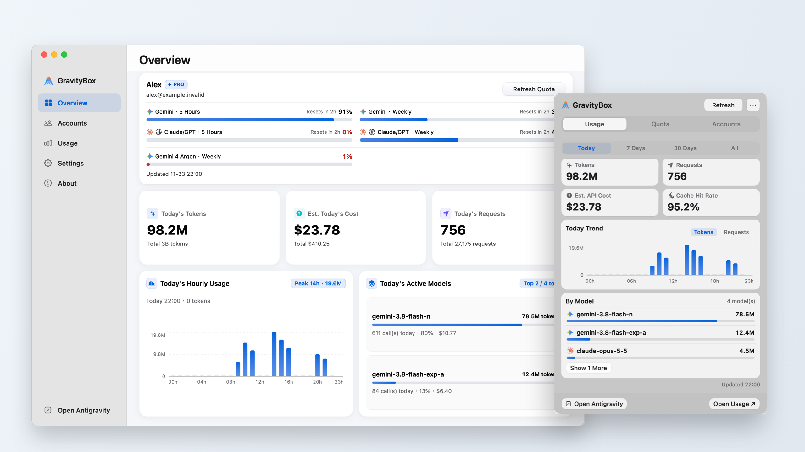
  </picture>
  <sub><em>Swift 6 / AppKit Console and Menu Bar Floating Panel (adapts to macOS Light and Dark appearance)</em></sub>
</div>

---

## Overview

**GravityBox** (`GravityBox v1.1.3`) is a lightweight, native macOS utility for the official stable release of `/Applications/Antigravity.app`. It embeds a self-contained Node 22 engine and communicates via local loopback CDP and read-only SQLite transactions—never unpacking, modifying, or re-signing the official application bundle.

| Capability | What It Solves |
| :--- | :--- |
| **Runtime Localization** | Dynamically toggles Antigravity UI between English and Simplified Chinese (`2.23.0`–`2.33.0` verified dictionaries plus adaptive fallback for `2.34.0+`) with zero binary patches. Prompts, chats, code, and terminal output remain untouched. |
| **In-IDE Telemetry HUD** | Mounts a compact 3-capsule toolbar below each chat composer displaying turn time, TPS, token totals, cache hit rate, compaction state, and model context usage. |
| **Dual-Window Quotas & Usage** | Separates **5-Hour** rolling limits from **Weekly** caps and standalone high-tier pools (e.g. `Gemini 4 Argon`), aggregates thinking variants (`-low` to `-max`) in summaries, and tracks historical spend via dated official API rates. |
| **Multi-Account & CLI Sync** | Supports zero-config session capture, batch JSON import/export (`0600`), standby recommendations, non-invasive `agy` CLI token sync, and atomic 4-phase manual switching with rollback. |
| **Reversible Storage Trim** | Moves runtime caches and optional aged task logs to macOS Trash with one-click undo, while locking credentials, workspaces, and active chats behind a strict allowlist. |

---

## Quick Start

1. **Install**: Download `GravityBox-<version>-x86_64.dmg` from [GitHub Releases](https://github.com/lihaiyun-shuimu/gravitybox-x86-arm64-mac/releases/latest) (Apple Silicon users can download `arm64` from [upstream](https://github.com/Enzoo404/gravitybox/releases/latest)), drag **GravityBox.app** into **Applications**, and clear Gatekeeper quarantine once (open-source builds are not Apple-notarized):
   ```bash
   xattr -cr /Applications/GravityBox.app
   ```
2. **Launch & Connect**: Open **GravityBox** and start official **Antigravity** from the sidebar/menu bar (`Open Antigravity`). If Antigravity `2.33.0+` was opened externally without a remote debugging port, GravityBox surfaces a banner—click **Safe Relaunch to Connect** for a clean restart without force-killing active work.
3. **Use Across Three Surfaces**: Glance at the **HUD** below the composer while coding, click the **Menu Bar Panel** (`⌘1` / `⌘2` / `⌘3`) for instant checks across full-screen Spaces, or open the **Main Console** (`Overview · Accounts · Usage · Settings · About`).

---

## In-IDE Telemetry HUD

The HUD embeds cleanly beneath every Antigravity composer without overlapping controls or taking keyboard focus.

<div align="center">
  <picture>
    <source media="(prefers-color-scheme: dark)" srcset="assets/screenshots/en-hud-dark.png" />
    
  </picture>
</div>

<br />

<div align="center">
  <picture>
    <source media="(prefers-color-scheme: dark)" srcset="assets/screenshots/en-hud-capsules-dark.png" />
    
  </picture>
</div>

| Segment | Readout & Indicators | Meaning |
| :--- | :--- | :--- |
| **1. Session & Speed** | `Gray` / `Solid Blue` / `Breathing Blue` dot + `3T · Turn 18s · 90 tok/s · 2` | Dot reflects foreground state (**Gray** idle/waiting or background-only subagents, **Solid Blue** streaming/thinking, **Breathing Blue** tool execution). Shows user turns, live turn elapsed time, output speed, and active subagent count. |
| **2. Tokens & Cache** | `58.6M tok · Cache Hit 97%` | Cumulative session + subagent token volume and prompt cache reuse share. |
| **3. Context Meter** | Badge (`1` / `2` / `3+`) + Model tag + Meter (`66%`) | Compaction count badge (hidden until compacted), short active model tag when switching or orchestrating, and context fill (`~` denotes reference estimate when upstream capacity is omitted). |

### Upward Detail Popovers

Hover over or click any capsule to inspect its breakdown (`Esc` or click outside to dismiss):

<table>
  <tr>
    <td width="33.3%" align="center">
      <b>Session Stats</b><br /><br />
      <picture>
        <source media="(prefers-color-scheme: dark)" srcset="assets/screenshots/en-hud-card-session-dark.png" />
        
      </picture>
    </td>
    <td width="33.3%" align="center">
      <b>Token Usage</b><br /><br />
      <picture>
        <source media="(prefers-color-scheme: dark)" srcset="assets/screenshots/en-hud-card-tokens-dark.png" />
        
      </picture>
    </td>
    <td width="33.3%" align="center">
      <b>Current Context (v1.1.3)</b><br /><br />
      <picture>
        <source media="(prefers-color-scheme: dark)" srcset="assets/screenshots/en-hud-card-context-dark.png" />
        
      </picture>
    </td>
  </tr>
</table>

<details>
<summary>Popover field highlights &amp; v1.1.3 context card updates</summary>

- **Session Stats**: Splits cumulative Model vs. Tool duration (with parallel tool intervals deduplicated), overall Avg TTFT/TPS, and latest foreground step TTFT/TPS plus subagent step totals.
- **Token Usage**: Breaks down Uncached Input, Cached Read, Cache Write, and Output (with `Reasoning / Reply` split when provided), plus step-locked equivalent API dollar spend (`≥ $X` when an unpriced model is present) and Cache Saved.
- **Current Context (`v1.1.3`)**: Single-line header with active role pill (`Exec` / `Plan`), two-color fill bar (Cached Context vs. New Uncached Input), latest step output, model peak context, and a unified **Prior Model Context** list with neutral frosted role pills and compaction counts.

</details>

---

## Console & Workflows

<table>
  <tr>
    <td width="50%" align="center">
      <b>Overview</b><br /><br />
      <picture>
        <source media="(prefers-color-scheme: dark)" srcset="assets/screenshots/en-dark-overview.png" />
        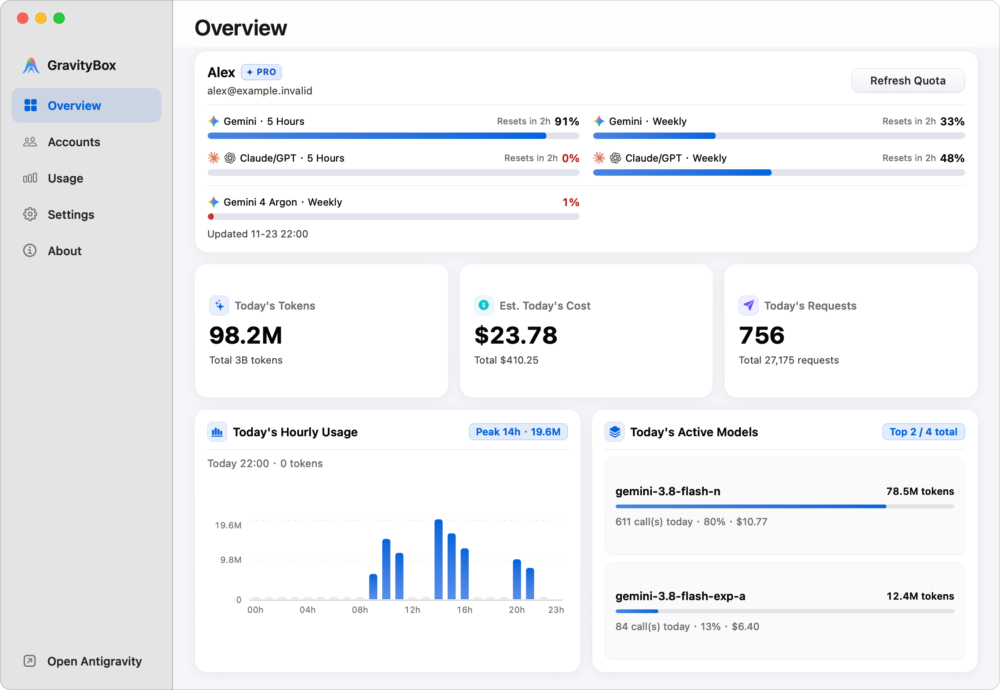
      </picture>
    </td>
    <td width="50%" align="center">
      <b>Accounts</b><br /><br />
      <picture>
        <source media="(prefers-color-scheme: dark)" srcset="assets/screenshots/en-dark-accounts.png" />
        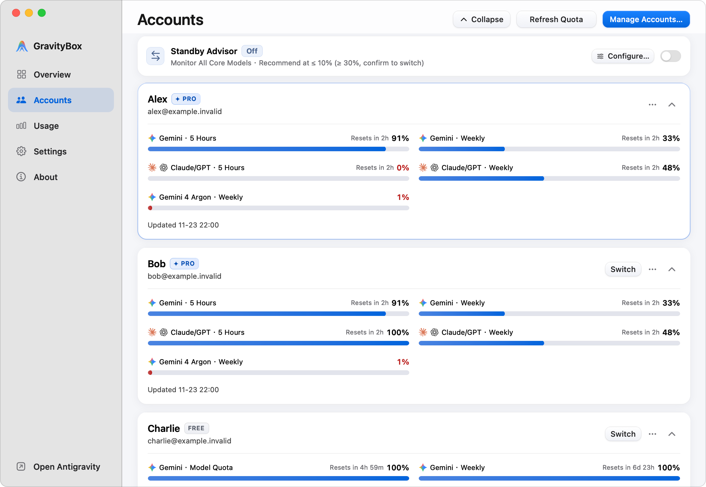
      </picture>
    </td>
  </tr>
  <tr>
    <td width="50%" align="center">
      <b>Usage &amp; API Cost</b><br /><br />
      <picture>
        <source media="(prefers-color-scheme: dark)" srcset="assets/screenshots/en-dark-usage.png" />
        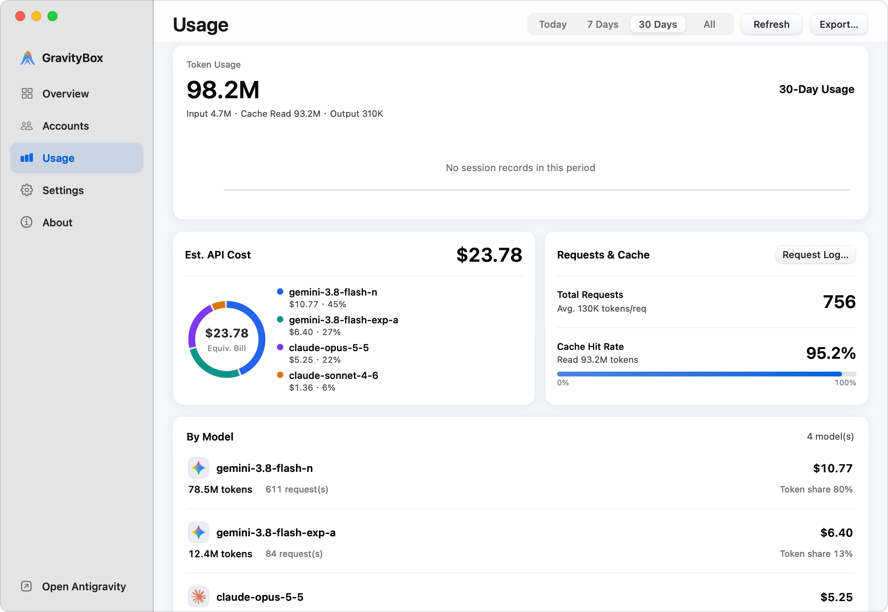
      </picture>
    </td>
    <td width="50%" align="center">
      <b>Settings</b><br /><br />
      <picture>
        <source media="(prefers-color-scheme: dark)" srcset="assets/screenshots/en-dark-settings.png" />
        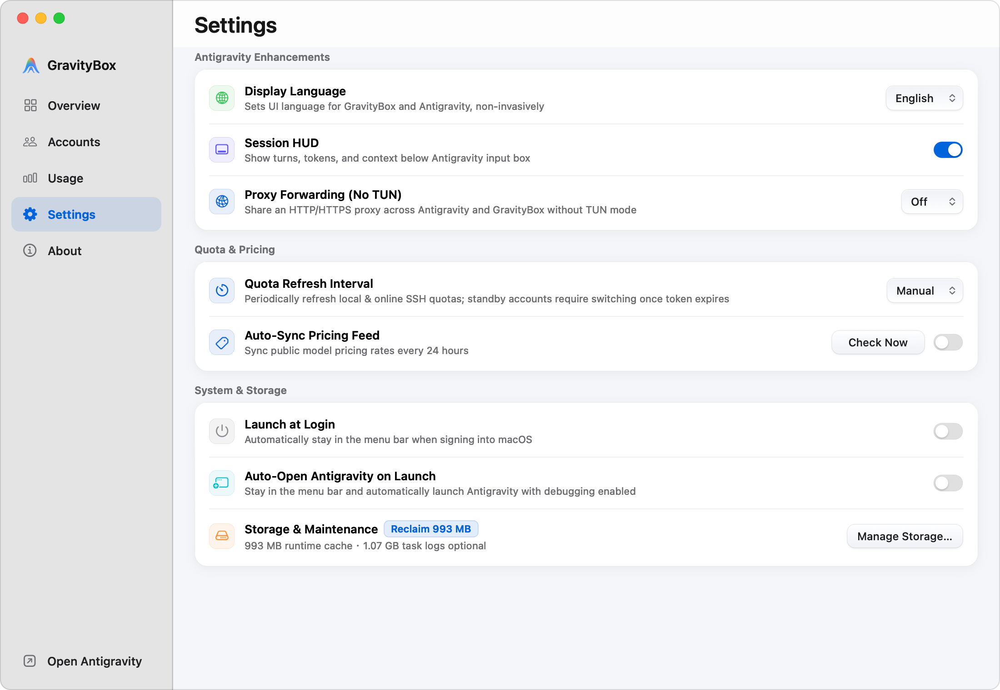
      </picture>
    </td>
  </tr>
</table>

<details>
<summary>More previews: Menu Bar Floating Panel, Storage Maintenance, and About</summary>
<br />
<table>
  <tr>
    <td width="33.3%" align="center">
      <b>Menu Bar · Usage</b><br /><br />
      <picture>
        <source media="(prefers-color-scheme: dark)" srcset="assets/screenshots/en-dark-menubar.png" />
        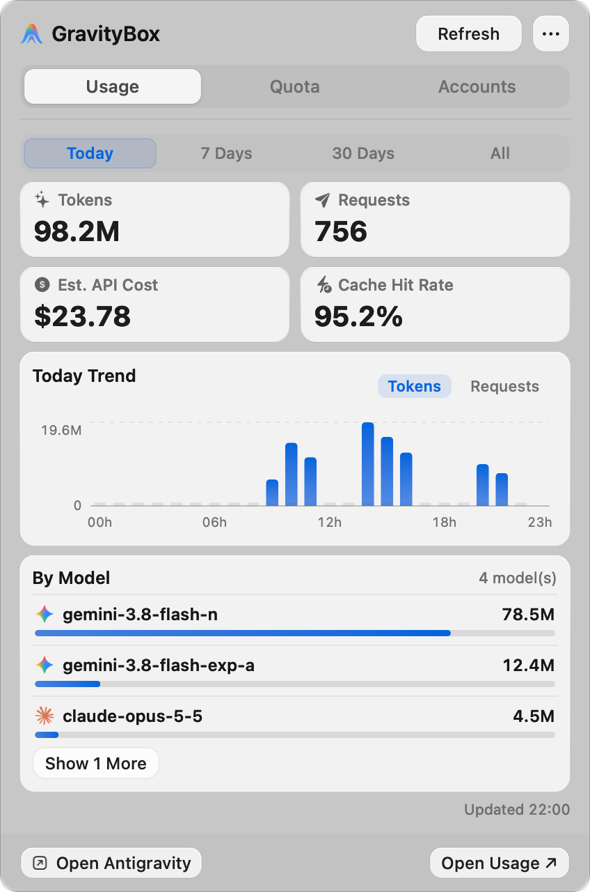
      </picture>
    </td>
    <td width="33.3%" align="center">
      <b>Menu Bar · Quota</b><br /><br />
      <picture>
        <source media="(prefers-color-scheme: dark)" srcset="assets/screenshots/en-dark-menubar-quota.png" />
        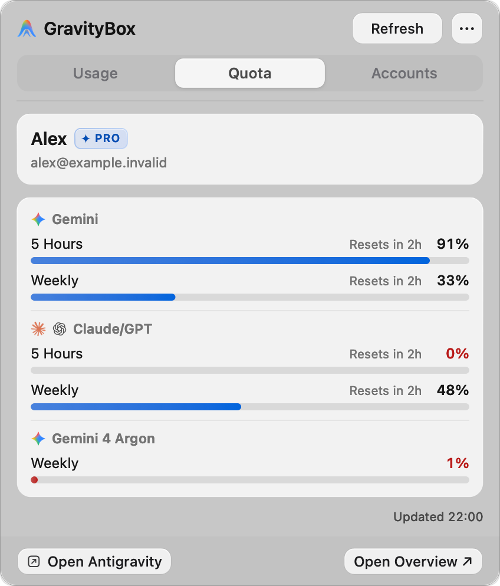
      </picture>
    </td>
    <td width="33.3%" align="center">
      <b>Menu Bar · Accounts</b><br /><br />
      <picture>
        <source media="(prefers-color-scheme: dark)" srcset="assets/screenshots/en-dark-menubar-accounts.png" />
        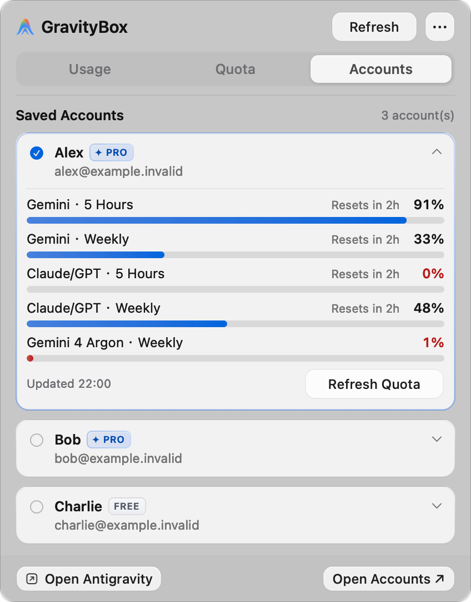
      </picture>
    </td>
  </tr>
  <tr>
    <td colspan="2" align="center">
      <b>Storage &amp; Maintenance (Trash + Undo)</b><br /><br />
      <picture>
        <source media="(prefers-color-scheme: dark)" srcset="assets/screenshots/en-dark-maintenance.png" />
        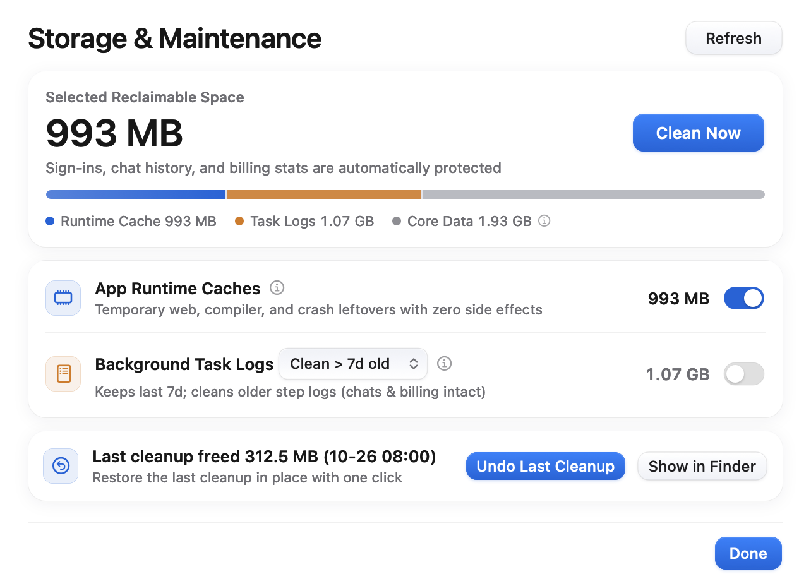
      </picture>
    </td>
    <td align="center">
      <b>About &amp; Updates</b><br /><br />
      <picture>
        <source media="(prefers-color-scheme: dark)" srcset="assets/screenshots/en-dark-about.png" />
        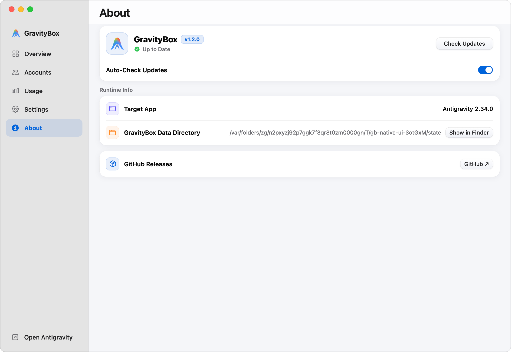
      </picture>
    </td>
  </tr>
</table>
</details>

### Key Behaviors in v1.1.3

- **Standby Account Quotas on Antigravity `2.34.0+`**: The active account refreshes passwordlessly via local process environment probing. Because `2.34.0` restricts local quota RPC to the active keychain session and GravityBox stays local-only without bundling official OAuth client secrets or relay servers, inactive standby accounts stop background cloud refreshes once their token expires (~1 hour). GravityBox refreshes right before expiry, skips expired polls silently without errors, marks passed reset timestamps as **Est. Reset**, factors likely-reset candidates into **Standby Advisor**, and syncs live balances as soon as you switch.
- **JSON Account Management & `agy` CLI Sync**: Save the live account, batch-import JSON files or directories (deduplicated by email), or export backups (`0600` after confirmation). Switching and rollback also sync existing same-origin CLI token files (`antigravity-oauth-token` and `jetski-standalone-oauth-token`) without touching `@google/gemini-cli` credentials.
- **Thinking-Variant Folding & Live Pricing Feed**: Usage cards fold `-low`, `-medium`, `-high`, `-xhigh`, `-thinking`, `-max`, and `-tiered` variants under each base model while preserving raw entries in **Request Log**. Enable **Auto-Sync Pricing Feed** (or click **Check Now**) to pull catalog updates via GitHub / jsDelivr with SHA-256 deduplication.
- **Independent Language & HUD Control**: Select `Follow System`, `English`, or `简体中文` in **Settings** (or the menu bar `···` menu) to hot-switch both apps; you can keep Antigravity in clean English while keeping the English HUD enabled.

---

## Installation

- **Requirements**: macOS 14 (Sonoma) or macOS 15+ (Sequoia), Intel / x86_64 Mac (including AMD Hackintosh; Apple Silicon builds available from [upstream](https://github.com/Enzoo404/gravitybox/releases/latest)), official unmodified `/Applications/Antigravity.app` (Insiders is neither supported nor altered), and zero external runtime dependencies.
- **Verify Checksum (optional)**:
  ```bash
  shasum -a 256 -c GravityBox-<version>-x86_64.dmg.sha256
  ```
- **Non-Destructive Upgrades**: Quit GravityBox and drag the new app over `/Applications/GravityBox.app`, or enable **Auto-Check Updates** in **About** (off by default; automatically pulls `x86_64` releases from this repository). Accounts, ledgers, custom dictionary overrides, and cleanup recovery points live in `~/Library/Application Support/GravityBox`.

<details>
<summary>Optional: Background OAuth refresh credentials for expired standby accounts</summary>

No `.env` setup is required for daily use, active-account live quotas, HUD, usage accounting, or switching. If you provide your own compatible OAuth client credentials for continuous background cloud polling of expired standby accounts, place them in `~/Library/Application Support/GravityBox/.env`:

```bash
GRAVITYBOX_GOOGLE_CLIENT_ID="your-client-id.apps.googleusercontent.com"
GRAVITYBOX_GOOGLE_CLIENT_SECRET="your-client-secret"
```

</details>

---

## Security & Privacy

| Guarantee | Mechanism |
| :--- | :--- |
| **Zero Telemetry** | No analytics SDKs, crash reporting, or unprompted outbound traffic. Update checks and remote pricing sync default to Off. |
| **Untouched Official App** | Runs via local loopback (`127.0.0.1`) CDP isolated worlds; never unpacks or alters `/Applications/Antigravity.app`. |
| **Protected User Content** | Composers, drafts, chat history, code blocks, terminal logs, and workspace names are excluded by DOM allowlists/guards. |
| **Local-Only Storage** | All state, SQLite ledgers, backups, and snapshots stay inside `~/Library/Application Support/GravityBox` (`0700`/`0600`). |

---

## Architecture & Build

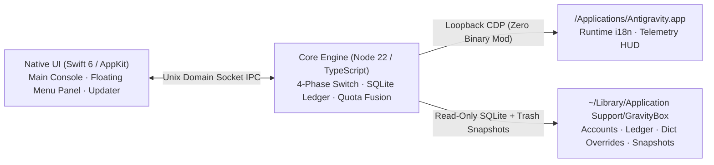

Requires Xcode Command Line Tools and Node.js `>=22.15.0 <23`:

```bash
git clone https://github.com/lihaiyun-shuimu/gravitybox-x86-arm64-mac.git
cd gravitybox-x86-arm64-mac
npm ci

npm test                    # Build TS, verify pricing parity, and run unit/integration suites
npm run check:swift         # Typecheck Swift 6 AppKit UI (auto-selects x86_64 / arm64)
npm run package:mac:x64     # Build Intel (x86_64) .app, .dmg, and .sha256 (see X86_64.md)
npm run package:mac         # Build Apple Silicon (arm64) .app and .dmg with full verify gate
```

<details>
<summary>Repository layout</summary>

```text
gravitybox/
├── native/       # Swift 6 / AppKit console, MenuFloatingPanel, L10n runtime, updater
├── src/          # Node 22 / TypeScript backend (IPC, i18n, atomic switch, quota, SQLite ledger, HUD)
├── runtime/      # CDP isolated-world scripts (DOM localization engine, guards, Telemetry HUD)
├── dict/         # Layered bilingual dictionaries and custom overrides
├── ui-strings/   # Versioned official bundle extraction snapshots (2.23.0 – 2.33.0)
├── assets/       # Icons, i18n JSON packs, model catalog, pricing feed, Retina screenshots
├── test/         # Unit, integration, headless Chromium E2E, and Swift UI layout suites
└── tools/        # Release integrity, privacy check, docs parity, screenshot & DMG scripts
```

</details>

---

## FAQ

<details>
<summary><b>Why must Antigravity be closed before switching accounts?</b></summary>

Antigravity holds live SQLite (`state.vscdb`) and credential locks while running. Force-killing or overwriting files underneath an active instance risks database corruption or lost drafts. GravityBox checks for a clean exit first, writes via a 4-phase snapshot transaction, and rolls back automatically on failure—requiring user confirmation every time.

</details>

<details>
<summary><b>Can I use only the Telemetry HUD without translating the IDE?</b></summary>

Yes. Set **Settings → Display Language** to **English** and keep **Session HUD** enabled. Both GravityBox and Antigravity stay in English while displaying the English HUD beneath the chat composer.

</details>

<details>
<summary><b>How do I uninstall GravityBox?</b></summary>

Quit GravityBox (Antigravity requires no cleanup because its files are never altered), move `/Applications/GravityBox.app` to Trash, and optionally remove `~/Library/Application Support/GravityBox`.

</details>

---

## Contributing & License

See [X86_64.md](./X86_64.md), [CONTRIBUTING.md](./CONTRIBUTING.md), [CODE_OF_CONDUCT.md](./CODE_OF_CONDUCT.md), [SECURITY.md](./SECURITY.md), and [CHANGELOG.md](./CHANGELOG.md). Feedback and bug reports for the x86_64 build are welcome via [GitHub Issues](https://github.com/lihaiyun-shuimu/gravitybox-x86-arm64-mac/issues). Upstream original project: [Enzoo404/gravitybox](https://github.com/Enzoo404/gravitybox).

<div align="center">
  <a href="https://star-history.com/#lihaiyun-shuimu/gravitybox-x86-arm64-mac&Date">
    
  </a>
</div>

<p align="center">
  <sub>Forked from <a href="https://github.com/Enzoo404/gravitybox">Enzoo404/gravitybox</a> · Released under the <a href="./LICENSE">MIT License</a> · Third-party notices in <a href="./THIRD_PARTY_NOTICES.md">THIRD_PARTY_NOTICES.md</a> · Not affiliated with or endorsed by Google or Antigravity.</sub>
</p>
