> [!IMPORTANT]
> **x86 Mac 版（Intel / x86_64）非官方社区分支** · 本仓库 fork 自 [Enzoo404/gravitybox](https://github.com/Enzoo404/gravitybox)，提供 Intel / AMD 黑苹果原生构建，并已将应用内检查更新切换至本仓库 `x86_64` 通道。
> 可直接前往本仓库 [Releases](https://github.com/lihaiyun-shuimu/gravitybox-x86-arm64-mac/releases/latest) 下载 `x86_64` 安装包，或阅读 **[X86_64.md](X86_64.md)** 了解详情与源码构建方式。

<div align="center">
  <a href="https://github.com/lihaiyun-shuimu/gravitybox-x86-arm64-mac">
    
  </a>

  <h1>GravityBox · x86 Mac 版</h1>

  <p>
    <strong>面向 Intel (x86_64) 与 Apple Silicon Mac 的 Google Antigravity 原生增强伴侣</strong><br />
    零改包双语适配 · 输入框 Telemetry HUD · 双周期配额账单 · 多账号安全切换 · 可撤回缓存瘦身
  </p>

  <p>
    <a href="https://github.com/lihaiyun-shuimu/gravitybox-x86-arm64-mac/releases/latest"></a>
    
    <a href="https://github.com/Enzoo404/gravitybox"></a>
    <a href="./LICENSE"></a>
  </p>

  <p>
    <a href="./README.md">English</a> · <b>简体中文</b>
  </p>

  <p>
    <a href="#概览">概览</a> ·
    <a href="#快速上手">快速上手</a> ·
    <a href="#对话状态栏-hud">对话状态栏 HUD</a> ·
    <a href="#界面与核心机制">界面与机制</a> ·
    <a href="#安装与升级">安装与升级</a> ·
    <a href="#安全与隐私边界">安全边界</a> ·
    <a href="#架构与源码构建">源码构建</a>
  </p>
</div>

<br />

<div align="center">
  <picture>
    <source media="(prefers-color-scheme: dark)" srcset="assets/screenshots/hero-dark.png" />
    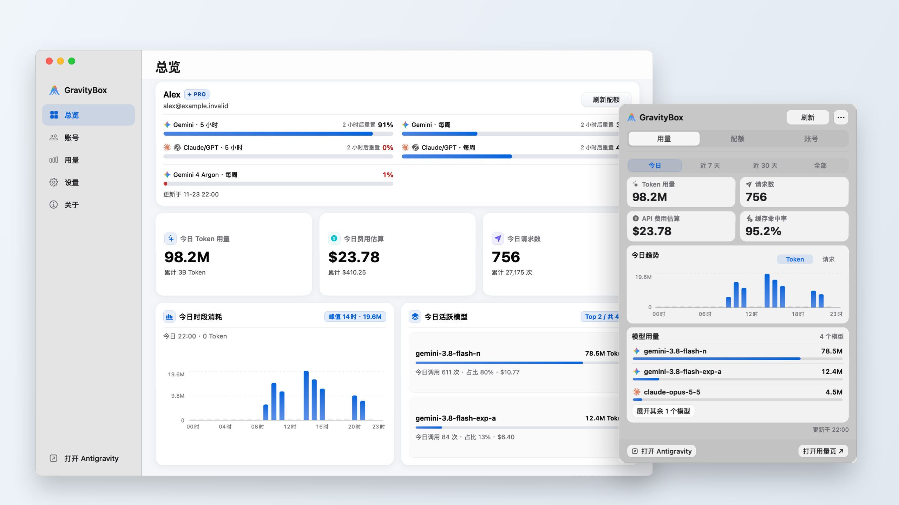
  </picture>
  <sub><em>Swift 6 / AppKit 原生主控制台与菜单栏浮窗（跟随系统浅色与深色模式自动切换）</em></sub>
</div>

---

## 概览

**GravityBox**（`GravityBox v1.1.3`）专为官方正式版 `/Applications/Antigravity.app` 设计，内置独立 Node 22 运行时，通过本机回环 CDP 与只读 SQLite 事务工作，不解包、不篡改、不重签名官方应用包。

| 核心能力 | 解决什么问题 |
| :--- | :--- |
| **零改包双语适配** | 运行时动态切换简体中文与英文界面（词典指纹已覆盖 `2.23.0`–`2.33.0`，`2.34.0+` 自动进入自适应兼容模式），同时保护对话内容、代码块与终端输出不被改动。 |
| **对话状态栏 (HUD)** | 在每个聊天输入框正下方嵌入三联遥测条，实时展示轮次用时、输出速度、Token 消耗、缓存命中率、压缩次数与上下文水位。 |
| **双周期配额与账单** | 将 **5 小时** 滚动限额、**每周** 限额与独立高阶池（如 `Gemini 4 Argon`）拆开展示；汇总页自动合并同一模型的各思考档位变体（`-low` 至 `-max`），并按时序官方单价核算等效 API 费用。 |
| **多账号与 CLI 同步** | 支持保存当前会话、JSON 批量导入与 `0600` 导出备份、低配额智能推荐、同源 `agy` CLI 凭据非侵入同步，以及四阶段原子安全切换与异常自动回滚。 |
| **可撤回缓存瘦身** | 仅清理无状态运行缓存与可选超期后台日志（清理前归档账单），统一移入系统废纸篓并支持一键原位还原，登录凭据与聊天正文受白名单隔离保护。 |

---

## 快速上手

1. **下载与安装**：前往本仓库 [GitHub Releases](https://github.com/lihaiyun-shuimu/gravitybox-x86-arm64-mac/releases/latest) 获取最新 `GravityBox-<version>-x86_64.dmg`（Apple Silicon 用户请前往[上游 Releases](https://github.com/Enzoo404/gravitybox/releases/latest) 下载 `arm64` 版），将 **GravityBox.app** 拖入 **Applications**。因开源版本未经过 Apple 付费公证，首次运行前在终端执行一次放行命令即可（也可在「系统设置 → 隐私与安全性」点击仍要打开）：
   ```bash
   xattr -cr /Applications/GravityBox.app
   ```
2. **启动并连接**：打开 **GravityBox**，通过侧栏或菜单栏点击 **「打开 Antigravity」**。若 `2.33.0+` 客户端是从外部直接启动且未开启调试端口，面板会弹出「未开启调试端口」横幅，点击 **「安全重启以连接」** 即可直接优雅重启并挂载（不在后台强杀进程）。
3. **日常协作**：写代码时直接看输入框下方 **HUD**；查额度/快速切号直接唤起 **菜单栏浮窗**（支持 `⌘1/2/3` 快捷键与全屏跨空间展示）；深度分析与整理打开 **主控制台**（总览 · 账号 · 用量 · 设置 · 关于）。

---

## 对话状态栏 (HUD)

HUD 挂载于每个 Antigravity 对话输入框下方，支持分栏独立状态且不抢占输入焦点。

<div align="center">
  <picture>
    <source media="(prefers-color-scheme: dark)" srcset="assets/screenshots/hud-dark.png" />
    
  </picture>
</div>

<br />

<div align="center">
  <picture>
    <source media="(prefers-color-scheme: dark)" srcset="assets/screenshots/hud-capsules-dark.png" />
    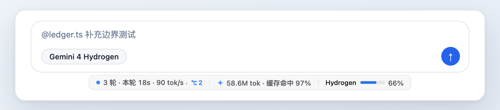
  </picture>
</div>

| 位置 | 示例读数 | 说明 |
| :--- | :--- | :--- |
| **1. 对话与速度** | 灰 / 实心蓝 / 呼吸蓝圆点 + `3 轮 · 本轮 18s · 90 tok/s · 2` | 状态灯指示当前前台活动（**灰** 空闲或仅后台子智能体运行，**实心蓝** 模型思考/输出，**呼吸蓝** 工具调用）；右侧依次为轮次、当前轮用时、平均吐字速度及并行子智能体数量。 |
| **2. Token 与缓存** | `58.6M tok · 缓存命中 97%` | 本会话（含关联子智能体）累计消耗总 Token 及输入缓存复用比例。 |
| **3. 上下文水位** | 压缩徽章 (`1` / `2` / `3+`) + 模型短标 + 进度条 (`66%`) | 发生自动压缩后才显现对应颜色角标；多模型或编排场景显示当前模型简称；未返回精确容量时带 `~` 按参考上限估算。 |

### 向上展开详情卡片

悬停或点击任意胶囊可弹出明细卡片（`Esc` 或点击空白处收起）：

<table>
  <tr>
    <td width="33.3%" align="center">
      <b>对话统计</b><br /><br />
      <picture>
        <source media="(prefers-color-scheme: dark)" srcset="assets/screenshots/hud-card-session-dark.png" />
        
      </picture>
    </td>
    <td width="33.3%" align="center">
      <b>Token 用量</b><br /><br />
      <picture>
        <source media="(prefers-color-scheme: dark)" srcset="assets/screenshots/hud-card-tokens-dark.png" />
        
      </picture>
    </td>
    <td width="33.3%" align="center">
      <b>当前上下文 (v1.1.3)</b><br /><br />
      <picture>
        <source media="(prefers-color-scheme: dark)" srcset="assets/screenshots/hud-card-context-dark.png" />
        
      </picture>
    </td>
  </tr>
</table>

<details>
<summary>卡片指标补充与 v1.1.3 上下文卡片变更</summary>

- **对话统计**：拆分模型与工具累计耗时（自动合并并行工具重叠时间），展示全局平均与最近一步的 TTFT / TPS，以及子智能体运行步数。
- **Token 用量**：细分为未缓存输入、缓存读取、缓存写入与输出（模型支持时自动拆分 `思维链 / 回复`），并按当时生效费率折算等效 API 费用与缓存节省金额（含未公开定价模型时显示 `≥ $X`）。
- **当前上下文（`v1.1.3`）**：单行标题融合当前模型名与角色徽章（`规划` / `执行`），以统一原生磨砂中性灰胶囊在 **曾用模型上下文** 列表展示切换过的模型水位与压缩次数。

</details>

---

## 界面与核心机制

<table>
  <tr>
    <td width="50%" align="center">
      <b>总览</b><br /><br />
      <picture>
        <source media="(prefers-color-scheme: dark)" srcset="assets/screenshots/dark-overview.png" />
        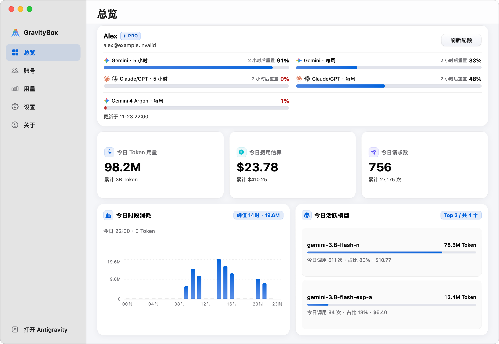
      </picture>
    </td>
    <td width="50%" align="center">
      <b>账号</b><br /><br />
      <picture>
        <source media="(prefers-color-scheme: dark)" srcset="assets/screenshots/dark-accounts.png" />
        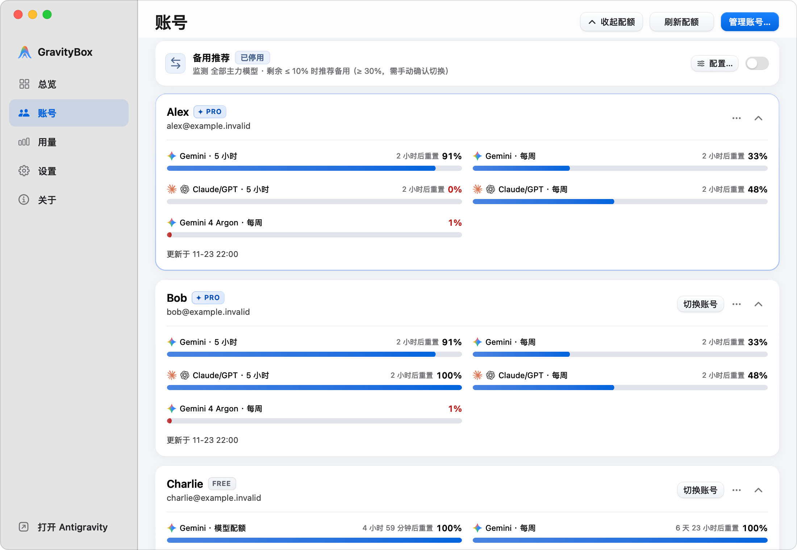
      </picture>
    </td>
  </tr>
  <tr>
    <td width="50%" align="center">
      <b>用量与费用</b><br /><br />
      <picture>
        <source media="(prefers-color-scheme: dark)" srcset="assets/screenshots/dark-usage.png" />
        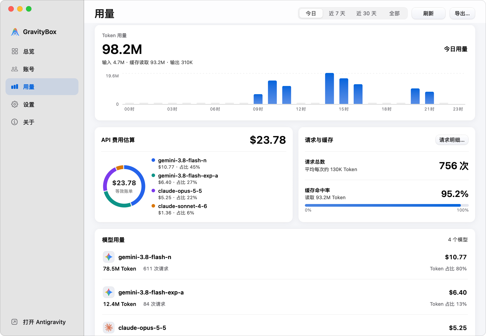
      </picture>
    </td>
    <td width="50%" align="center">
      <b>设置</b><br /><br />
      <picture>
        <source media="(prefers-color-scheme: dark)" srcset="assets/screenshots/dark-settings.png" />
        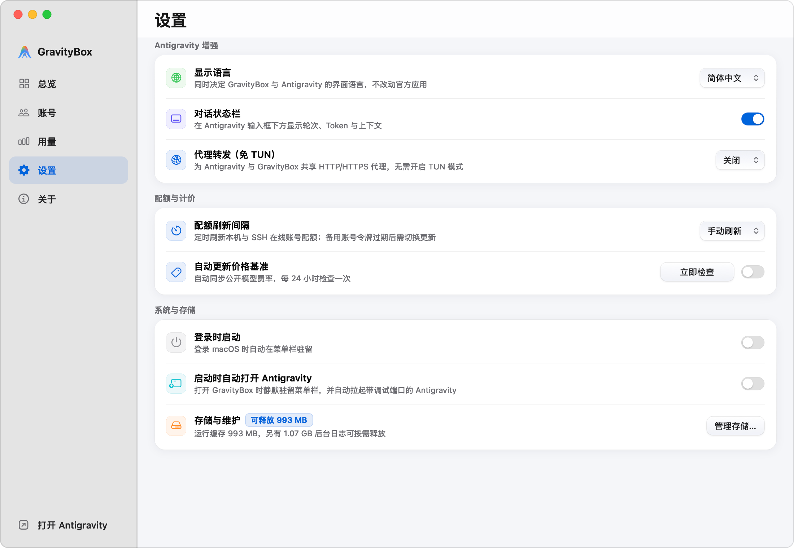
      </picture>
    </td>
  </tr>
</table>

<details>
<summary>展开更多截图：常驻菜单栏浮窗、存储与维护、关于页面</summary>
<br />
<table>
  <tr>
    <td width="33.3%" align="center">
      <b>菜单栏 · 用量</b><br /><br />
      <picture>
        <source media="(prefers-color-scheme: dark)" srcset="assets/screenshots/dark-menubar.png" />
        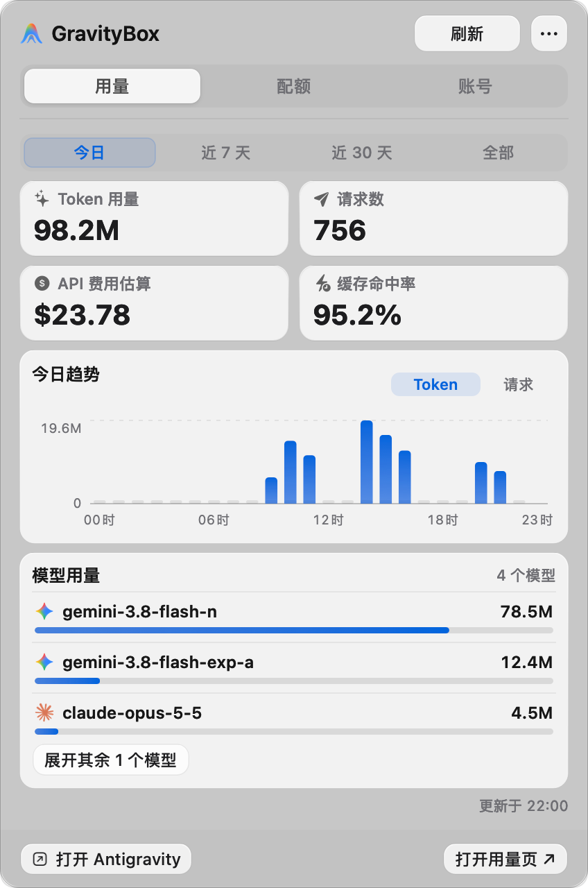
      </picture>
    </td>
    <td width="33.3%" align="center">
      <b>菜单栏 · 配额</b><br /><br />
      <picture>
        <source media="(prefers-color-scheme: dark)" srcset="assets/screenshots/dark-menubar-quota.png" />
        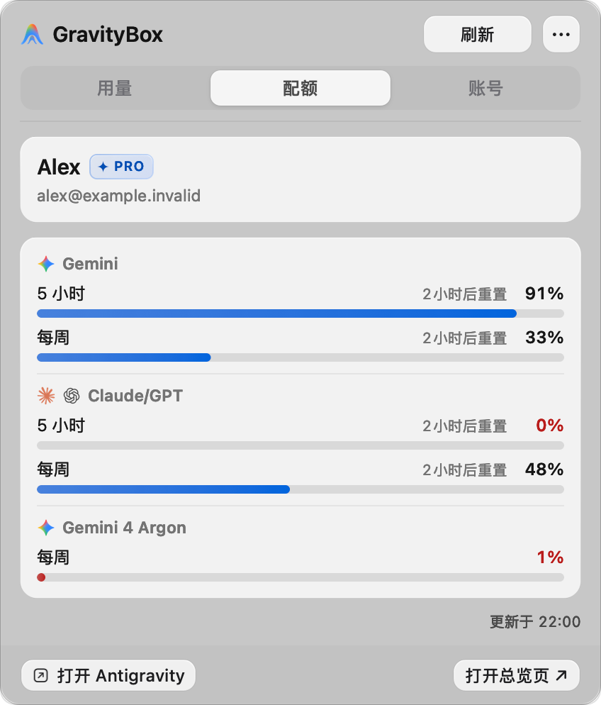
      </picture>
    </td>
    <td width="33.3%" align="center">
      <b>菜单栏 · 账号</b><br /><br />
      <picture>
        <source media="(prefers-color-scheme: dark)" srcset="assets/screenshots/dark-menubar-accounts.png" />
        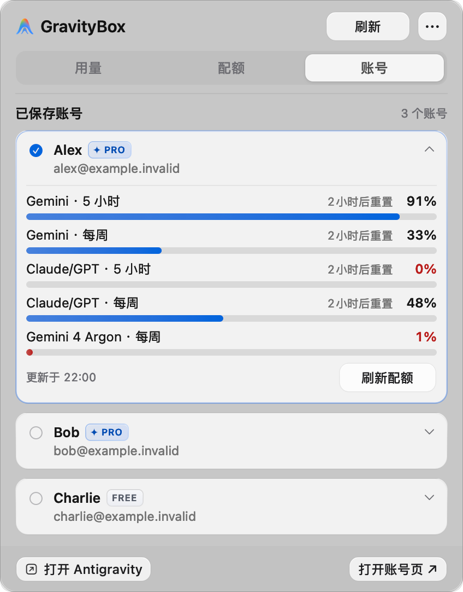
      </picture>
    </td>
  </tr>
  <tr>
    <td colspan="2" align="center">
      <b>存储与维护（废纸篓清理与原位还原）</b><br /><br />
      <picture>
        <source media="(prefers-color-scheme: dark)" srcset="assets/screenshots/dark-maintenance.png" />
        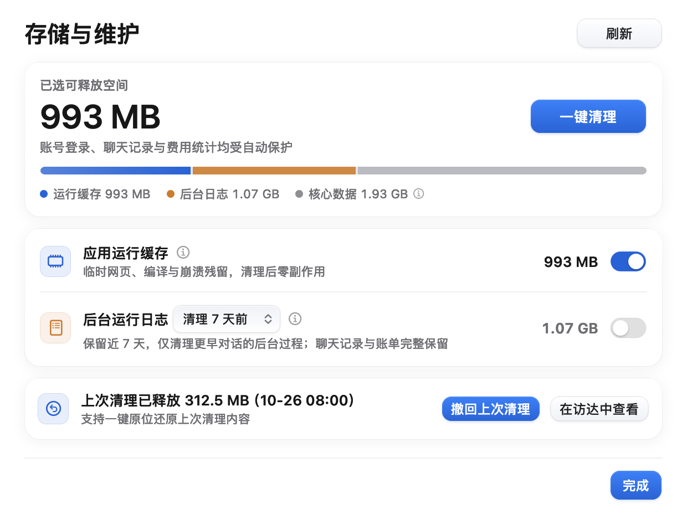
      </picture>
    </td>
    <td align="center">
      <b>关于与更新</b><br /><br />
      <picture>
        <source media="(prefers-color-scheme: dark)" srcset="assets/screenshots/dark-about.png" />
        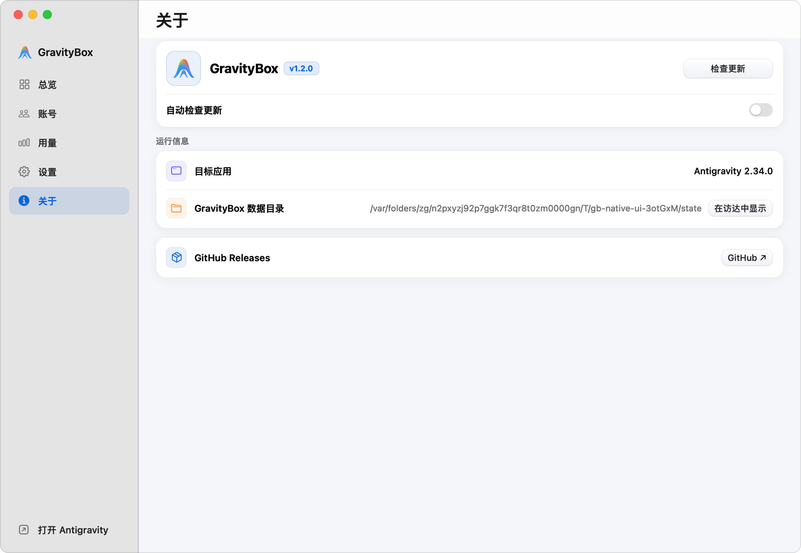
      </picture>
    </td>
  </tr>
</table>
</details>

### v1.1.3 核心机制说明

- **Antigravity `2.34.0+` 备用账号配额追踪**：当前正在使用的账号通过进程环境变量读取，无需额外配置即可持续实时刷新。受 `2.34.0` 本地通道仅限单一活跃钥匙串会话、以及 GravityBox 坚持纯本地开源（不内置官方客户端密钥、不设中转服务器）的限制，未激活的备用账号离开约 1 小时登录态过期后不再后台拉取云端额度；GravityBox 会在过期前自动补刷、超时后静默跳过不弹窗报错、保留上次快照并按重置时间标示 **「预计已重置」** 供智能推荐参考，待手动切回该账号时同步最新余额。
- **JSON 批量管理与 `agy` CLI 同步**：在账号页头部 **「管理账号…」** 中集成了保存当前账号、JSON 文件/目录批量导入（按邮箱去重）与二次确认 `0600` 备份导出；切号与撤销回滚时会顺带更新本机已存在的 `antigravity-oauth-token` 与 `jetski-standalone-oauth-token`，不干扰 `@google/gemini-cli` 凭据。
- **思考档位折叠与价格表热更新**：主界面与菜单栏自动将同一基础模型的 `-low`、`-medium`、`-high`、`-xhigh`、`-thinking`、`-max`、`-tiered` 等变体合并展示汇总消耗（请求明细流水保留原始标识）；开启 **「自动更新价格基准」** 或点击 **「立即检查」** 可在线热同步最新公开模型单价表。
- **独立双语与 HUD 开关**：在设置页或菜单栏 `···` 菜单随时切换 **跟随系统 / 简体中文 / English**，无需重启；选择 `English` 恢复官方英文界面时，仍可保持英文版 HUD 正常工作。

---

## 安装与升级

- **运行环境**：macOS 14 (Sonoma) 或 macOS 15+ (Sequoia)、Intel / x86_64 Mac（含 AMD 黑苹果；Apple Silicon 请下载[上游官方版](https://github.com/Enzoo404/gravitybox/releases/latest)）、官方原版 `/Applications/Antigravity.app`（需保留 Google 官方签名，不支持也不干扰 Insiders 预览版），安装包内置运行环境、零外部依赖。
- **SHA-256 校验（可选）**：
  ```bash
  shasum -a 256 -c GravityBox-<version>-x86_64.dmg.sha256
  ```
- **覆盖无损升级**：退出旧版 GravityBox 后将新版拖入 `/Applications` 替换，或在 **关于** 页点击检查更新（默认关闭后台检查，自动拉取本仓库 `x86_64` 版本）。账号库、历史账单、个人词典与恢复点均独立保存在 `~/Library/Application Support/GravityBox`。

<details>
<summary>进阶可选：为过期备用账号配置后台云端刷新凭据</summary>

日常使用（多账号切号、当前账号实时配额、HUD 状态栏、用量账单与汉化）无需此配置。仅当需要未激活备用账号在过期后继续自动拉取云端配额时，才需在 `~/Library/Application Support/GravityBox/.env` 中写入兼容的 OAuth 客户端凭据：

```bash
GRAVITYBOX_GOOGLE_CLIENT_ID="your-client-id.apps.googleusercontent.com"
GRAVITYBOX_GOOGLE_CLIENT_SECRET="your-client-secret"
```

</details>

---

## 安全与隐私边界

| 安全原则 | 工程实现 |
| :--- | :--- |
| **零遥测零上报** | 无第三方统计或崩溃上报 SDK，无后台静默外联请求；更新检查与价格同步默认均关闭。 |
| **不改动官方包** | 仅通过本机回环（`127.0.0.1`）CDP 隔离世界运行，不解包、不改写、不重签名 `/Applications/Antigravity.app`。 |
| **用户内容隔离** | 输入框草稿、对话正文、代码块、终端输出、文件名与项目名由 DOM 选择器与白名单严格隔离。 |
| **纯本地权限存储** | 所有账号元信息、钥匙串索引、SQLite 账本与快照均保留于 `~/Library/Application Support/GravityBox`（`0700`/`0600`）。 |

---

## 架构与源码构建

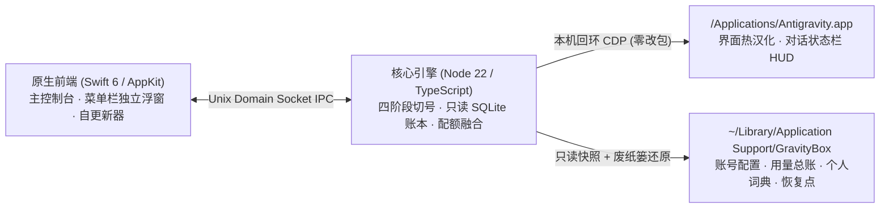

源码构建需本机安装 Xcode Command Line Tools 与 Node.js `>=22.15.0 <23`：

```bash
git clone https://github.com/lihaiyun-shuimu/gravitybox-x86-arm64-mac.git
cd gravitybox-x86-arm64-mac
npm ci

npm test                    # 编译 TS、校验价格资产并运行单元/集成测试
npm run check:swift         # Swift 6 AppKit 编译检查（自动匹配 x86_64 / arm64）
npm run package:mac:x64     # 构建 Intel (x86_64) .app、.dmg 与 .sha256（详见 X86_64.md）
npm run package:mac         # 构建 Apple Silicon (arm64) .app 与 .dmg 安装包
```

<details>
<summary>仓库目录结构</summary>

```text
gravitybox/
├── native/       # Swift 6 / AppKit 主控制台、MenuFloatingPanel、双语运行时与更新器
├── src/          # TypeScript 核心引擎（IPC、双语控制、四阶段切号、配额融合、SQLite 账本、HUD）
├── runtime/      # CDP 注入脚本（DOM 增量翻译、保护守卫与双语 Telemetry HUD）
├── dict/         # 分层词典与本地覆盖配置
├── ui-strings/   # 各受支持正式版官方界面文案快照（2.23.0 – 2.33.0）
├── assets/       # 图标、i18n 语言包、模型目录、时序价格表与 Retina 实机截图
├── test/         # 单元/集成、无头 Chromium 浏览器回归及原生 Swift UI 测试套件
└── tools/        # 发布完整性校验、隐私扫描、文档检查、截图生成与 macOS 打包脚本
```

</details>

---

## 常见问题

<details>
<summary><b>为什么切号前需要先退出 Antigravity？</b></summary>

Antigravity 运行时会持续持有本地 SQLite（`state.vscdb`）与认证文件锁，后台强杀或覆写运行中的数据库文件存在损库与草稿丢失风险。GravityBox 先确认安全退出，再执行四阶段快照切换并在异常时原位回滚，切号动作始终由你确认。

</details>

<details>
<summary><b>只想开启输入框 HUD，不汉化 Antigravity 可以吗？</b></summary>

可以。在 **设置 → 显示语言** 中选择 **English**，同时保持 **对话状态栏** 开关开启，Antigravity 将保持原生英文界面并在输入框下方展示英文 HUD。

</details>

<details>
<summary><b>如何卸载 GravityBox？</b></summary>

退出 GravityBox（官方 Antigravity 从未被修改过，无需额外还原），将 `/Applications/GravityBox.app` 移入废纸篓即可；如无需保留历史账单与账号配置，再删除 `~/Library/Application Support/GravityBox`。

</details>

---

## 参与贡献与开源协议

提交代码或反馈请先阅读 [X86_64.md](./X86_64.md)、[CONTRIBUTING.md](./CONTRIBUTING.md)、[CODE_OF_CONDUCT.md](./CODE_OF_CONDUCT.md)、[SECURITY.md](./SECURITY.md) 与 [CHANGELOG.md](./CHANGELOG.md)，x86_64 版问题欢迎在 [GitHub Issues](https://github.com/lihaiyun-shuimu/gravitybox-x86-arm64-mac/issues) 提交讨论。上游原项目：[Enzoo404/gravitybox](https://github.com/Enzoo404/gravitybox)。

<div align="center">
  <a href="https://star-history.com/#lihaiyun-shuimu/gravitybox-x86-arm64-mac&Date">
    
  </a>
</div>

<p align="center">
  <sub>Fork 自 <a href="https://github.com/Enzoo404/gravitybox">Enzoo404/gravitybox</a> · 基于 <a href="./LICENSE">MIT License</a> 开源 · 第三方许可见 <a href="./THIRD_PARTY_NOTICES.md">THIRD_PARTY_NOTICES.md</a> · 与 Google / Antigravity 官方无从属或背书关系。</sub>
</p>
